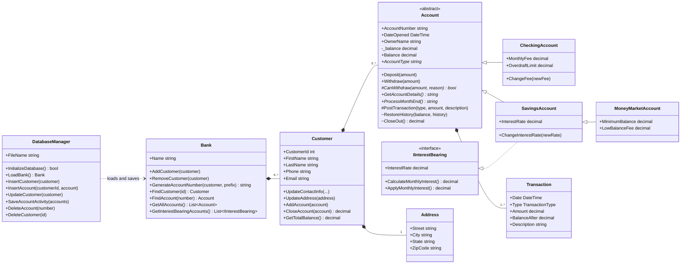
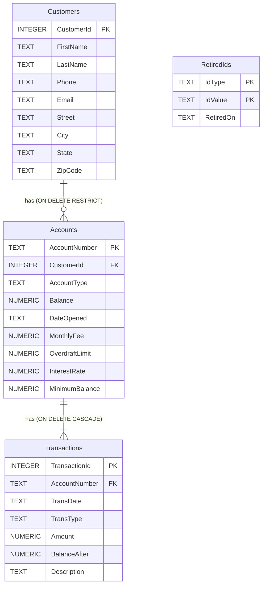
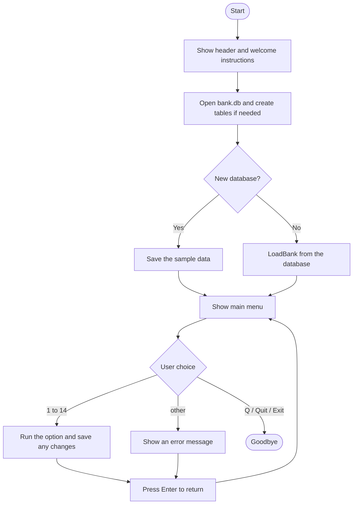

# Bank Account Manager - Design Diagrams

These diagrams summarize the final design. GitHub draws them from the Mermaid text below. The full User Interaction Document and Software Design Document were submitted as Word documents with the final project.

## Class Diagram

## Database Tables

## Main Menu Flow

